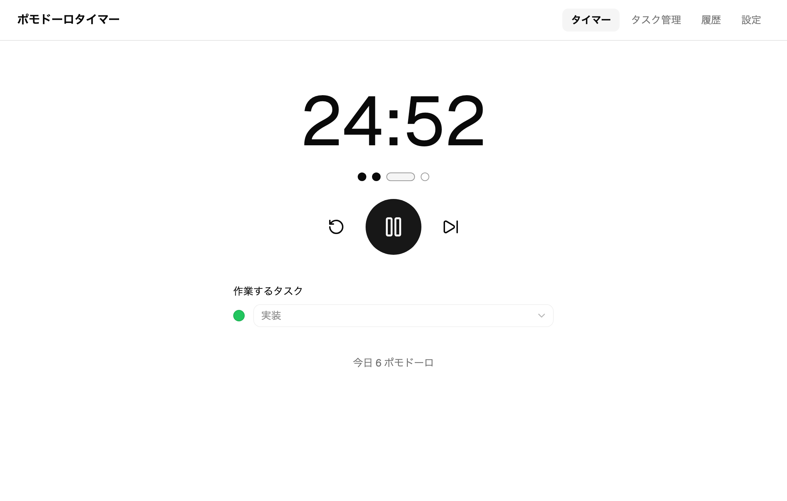
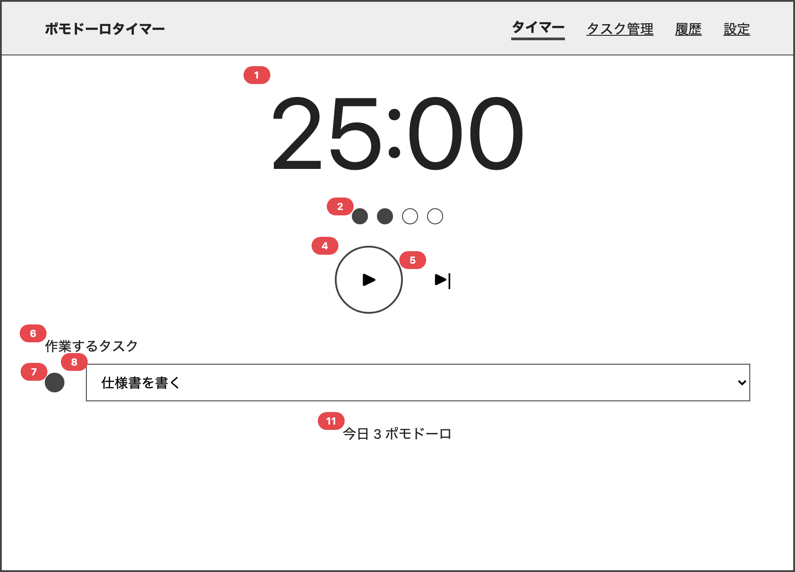
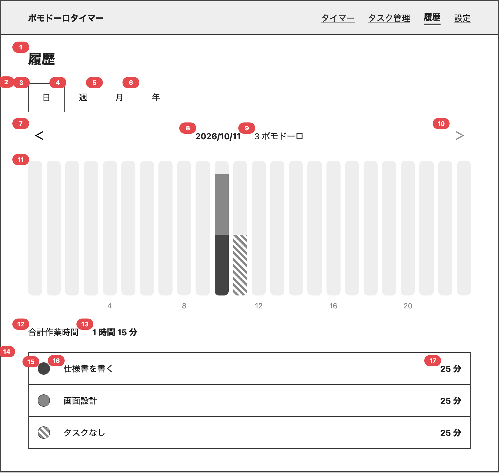
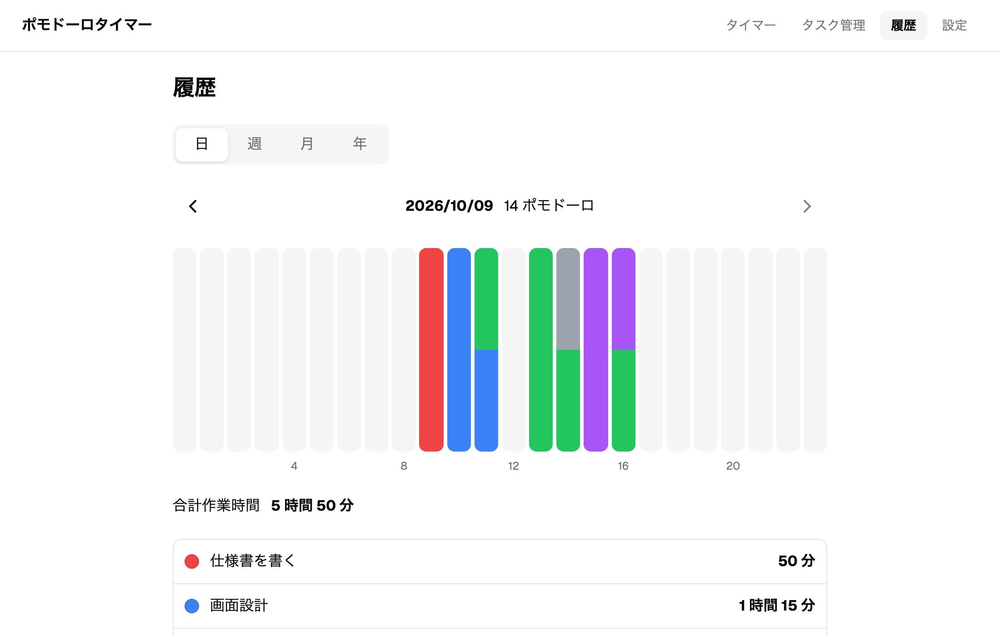
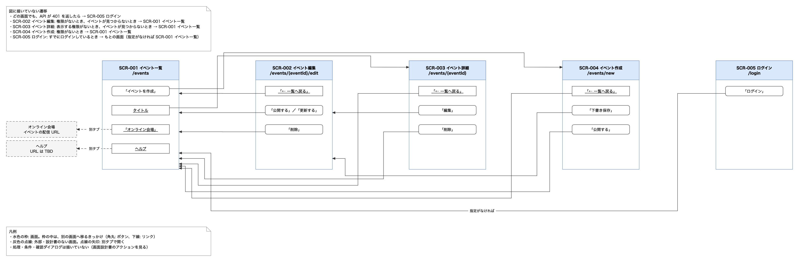

<!-- _class: lead -->
<!-- _paginate: false -->

# screen-design plugin の紹介

画面設計書作成のためのplugin

<span class="note">実装例: ポモドーロタイマー</span>

2026/10/16 平野大介

---

## 目次

1. screen-design plugin とは
2. 実装例: ポモドーロタイマー（デモ）
3. skill ごとに、何が作られるか
4. 感想

---

<!-- _class: chapter -->

# 1. screen-design plugin とは

---

## Pluginとは

Claude に、あとから足せる拡張のまとまり。(codexやcopilotでは)

- 中身は、skill や command や agent
- Git のリポジトリ（マーケットプレイス）で配る
- 入れると、`/skill 名` で呼べるようになる

```
# claude code のチャットで
/plugin marketplace add nebular-lab/nebular-plugins
/plugin install screen-design@nebular-plugins
```

---

## [screen-design plugin](https://github.com/nebular-lab/nebular-plugins/tree/main/plugins/screen-design) は何をするプラグインか

画面の設計書を、決まった形式で作るための skill 集。上から順に使う想定。

| 順  | skill                           | 作るもの                                                   |
| --- | ------------------------------- | ---------------------------------------------------------- |
| ①   | `/write-screen-common-rules`    | 全画面共通ルール　Markdown                                 |
| ②   | `/write-screen-wireframe`       | ワイヤーフレーム　HTML / CSS                               |
| ③   | `/write-screen-spec`            | 画面設計書　Markdown                                       |
| ④   | `/write-screen-flow`            | 画面遷移図　draw.io                                        |
| ⑤   | `/write-screen-playwright-test` | Playwright テストコード（TS） + 手動テストケース　Markdown |

---

## 作られるファイル

```
docs/screens/
├── overview.md          概要と画面一覧
├── common-rules.md      全画面共通ルール
├── messages.md          メッセージ一覧
├── storage.md           ブラウザストレージ一覧
├── wireframe.css        ワイヤーフレームの共通スタイル
├── HDR-001_app-header/  共通ヘッダー
└── SCR-002_timer/       画面ごとのフォルダ
    ├── SCR-002_timer.html             ワイヤーフレーム
    ├── SCR-002_timer.md               画面設計書
    ├── SCR-002_timer.spec.ts          Playwright テスト
    └── SCR-002_timer.manual-test.md   手動テスト
```

---

<!-- _class: chapter -->

# 2. 実装例: ポモドーロタイマー

---

## ポモドーロタイマー

普通のポモドーロタイマー。
タスクを紐づけてどんな作業をしたのか記録に残るようにしている。

<div class="cols">
<div>

- 画面は 4 つ
  - タイマー / タスク管理 / 履歴 / 設定
- ブラウザだけで動く
- React、TanStack Router、shadcn

</div>
<div>



</div>
</div>

---

<!-- _class: lead -->

# 簡単にデモ

---

<!-- _class: chapter -->

# 3. skill ごとに、何が作られるか

---

<!-- _class: small -->

## ① `/write-screen-common-rules`

全画面で同じになる扱いを決める。項目と選択肢はあらかじめ決まっていて、会話で選択する。

| 分類             | 設定項目の例                                                                        |
| ---------------- | ----------------------------------------------------------------------------------- |
| 入力             | 改行を 1 文字と数えるか、前後の空白を取り除くか、貼り付けの扱い、IME の変換中の扱い |
| 表示形式         | 数値を 3 桁ごとにカンマで区切るか                                                   |
| 一覧             | 一覧に戻ったときに、検索条件とページを復元するか                                    |
| 送信             | 送信中にボタンを非活性にするか                                                      |
| 通信             | 応答を待つ時間に上限を設けるか、待つのをやめたときの扱い                            |
| メッセージ       | トーストが重なったときの扱い                                                        |
| 遷移             | 戻ったときに、スクロール位置・入力内容を復元するか、離脱確認をするか                |
| アクセシビリティ | 選択肢のない、決まったルール                                                        |
| ライブラリの設定 | react-hook-form と TanStack Query の、既定の設定                                    |

sample: [common-rules.md](https://github.com/nebular-lab/nebular-plugins/blob/main/plugins/screen-design/examples/docs/screens/common-rules.md)

---

## ② `/write-screen-wireframe`

画面の構成を、**グレーの枠と本物のフォーム部品**だけの HTML で描く。

- デザインではなく、「何が、どの順に、どこに並ぶか」を合意するための図
- 説明やスクリーンショットを渡すと、先に下書きを描いてくれる
- 部品に**番号**を振る → これが、設計書の No になる
- 状態ごとの見え方（開始前・動作中・エラー表示など）も並べて描く

---

## なぜ、簡易 HTML なのか

| 案                         | 採否     | 理由                                                                   |
| -------------------------- | -------- | ---------------------------------------------------------------------- |
| Figma のスクリーンショット | 却下     | 直しにくい。部品に番号を付けにくい                                     |
| React などで実装したもの   | 却下     | 実装と設計書のズレはなくなるが、そもそも設計書を書く時点では実装されていないと思った |
| **簡易 HTML**              | **採用** | 実装と別の実装であれば、変更しやすい。         |

メリデメがあって、判断が難しい。

---

## 生成されるもの: `SCR-002_timer.html`

<div class="cols">
<div>



</div>
<div>

```html
<span class="huge" data-no="1">25:00</span>
<span class="dots" data-no="2">…</span>
<div class="row center">
  <button class="round" data-no="4">▶</button>
  <button class="plain" data-no="5">▶|</button>
</div>
```

- `data-no` が部品番号
- 共通の `wireframe.css` を使うので、HTML は短い
- ブラウザで開いて、そのまま確認できる

</div>
</div>

---

## ワイヤーフレーム → 実装

<div class="cols">
<div>



<span class="note">ワイヤーフレーム（履歴）</span>

</div>
<div>



<span class="note">実装した画面</span>

</div>
</div>

---

## ③ `/write-screen-spec`

設計書のテンプレートを決めておく。実装の前に決めておきたいことは、すべて書く。

| 項目                | 書くこと                                                                                                   |
| ------------------- | ---------------------------------------------------------------------------------------------------------- |
| 冒頭の表            | 画面 ID、URL、document.title、共通ヘッダー、初期フォーカス                                                 |
| 1. 概要             | 何の画面か                                                                                                 |
| 2. クエリパラメータ | 受け取る値と、受け取れない値のときの扱い                                                                   |
| 3. 閲覧権限         | 誰が見られるか                                                                                             |
| 4. 画面項目         | 入力項目 / ボタン・リンク / テキスト / その他。HTML の属性（`type`、`value`、`disabled` など）と、表示条件 |
| 5. 初期表示時の処理 | 画面を開いたときの手順                                                                                     |
| 6. アクション       | 操作ごとの手順                                                                                             |
| 7. 未決事項         | まだ決まっていないこと                                                                                     |

---

<!-- _class: tiny -->

## サンプル: `SCR-005_settings.md`（省略あり）

<div class="cols doc">
<div>

#### SCR-005 設定

| 項目           | 内容                 |
| -------------- | -------------------- |
| 画面 ID        | SCR-005              |
| URL            | `/settings`          |
| document.title | 設定                 |
| 共通ヘッダー   | HDR-001 共通ヘッダー |
| 初期フォーカス | -                    |

##### 1. 概要

タイマーの時間、サイクルの回数、自動スタートを変える画面。

##### 2. クエリパラメータ

なし

##### 3. 閲覧権限

| 利用者の種類 | 閲覧 |
| ------------ | ---- |
| 利用者       | ○    |

</div>
<div>

##### 4. 画面項目

<span class="later">→ 次のスライドで説明</span>

##### 5. 初期表示時の処理

1. 共通ヘッダーの初期表示時の処理が終わったあと、設定の値を No.3、No.5、No.7、No.9、No.10、No.11 に入れる。

##### 6. アクション

<span class="later">→ 次の次のスライドで説明</span>

##### 7. 未決事項

なし

</div>
</div>

---

<!-- _class: tiny -->

## 4. 画面項目: 部品の種類ごとに、表の列が決まっている。列名は、HTML の属性名

<div class="doc kinds">

**入力項目**

| No  | 項目名       | タグ    | `type` | `value` | `placeholder`          | `maxlength` | `autocomplete` | `inputmode` | `disabled` | 入力可能文字種 | その他の属性 | 備考          |
| --- | ------------ | ------- | ------ | ------- | ---------------------- | ----------- | -------------- | ----------- | ---------- | -------------- | ------------ | ------------- |
| 2   | 新しいタスク | `input` | `text` | 空      | 「新しいタスクを追加」 | -           | `off`          | -           | -          | -              | -            | 読み上げ名: … |

**ボタン・リンク**

| No  | 項目名   | タグ     | `type`   | `href` | `target` | 表示条件                       | `disabled` | その他の属性 | 備考                 |
| --- | -------- | -------- | -------- | ------ | -------- | ------------------------------ | ---------- | ------------ | -------------------- |
| 3   | リセット | `button` | `button` | -      | -        | 動作が動作中か一時停止中のとき | -          | -            | 読み上げ名: リセット |

**テキスト**

| No  | 項目名           | タグ    | 表示内容     | 表示条件 | その他の属性 | 備考 |
| --- | ---------------- | ------- | ------------ | -------- | ------------ | ---- |
| 2   | 作業時間の見出し | `label` | 「作業時間」 | 常に表示 | `for`: No.3  | -    |

**その他**（上のどれにも当たらない部品）

| No  | 項目名             | タグ           | 表示内容                               | 表示条件 | その他の属性 | 備考                           |
| --- | ------------------ | -------------- | -------------------------------------- | -------- | ------------ | ------------------------------ |
| 2   | サイクルの進み具合 | 実装時に決める | 設定のサイクルの数だけ、点を横に並べる | 常に表示 | -            | 読み上げ名: 「サイクル 2 / 4」 |

</div>

属性くらいなら、設計時点で決めておいてもいいかなと思った。
必要であれば、スクリーンリーダーで読み上げられる名前も決めておく。

---

<!-- _class: tiny -->

## 6. アクション（`SCR-005_settings.md`）

<div class="doc one">
<div>

##### 6. アクション

**アクション一覧**

| ID | 操作 | 対象 |
| --- | --- | --- |
| A1 | 設定の値を変える | No.3、No.5、No.7、No.9、No.10、No.11 |

**A1. 設定の値を変える**

値を変えた時点で行う（保存のボタンはない）。

1. 変えた項目の値を、設定にして、STG-001 に保存する（保存するのは、6 項目すべてを持つ値。タイマーは、次に開始するフェーズから、新しい設定を使う。進行中のフェーズの残り時間は変えない）。

</div>
</div>

- アクション一覧で、操作と、対象の部品（No）を対応させる
- 操作 1 つ = アクション 1 つ。手順を、番号つきで書く
- 保存する値は `STG-NNN`、メッセージは `MSG-NNN` で参照する

---

<!-- _class: small -->

## 一緒に作られるもの: 共有ファイル

<div class="cols">
<div>

### `messages.md`

| ID      | 種別   | 文言                                   |
| ------- | ------ | -------------------------------------- |
| MSG-001 | エラー | {v1}を入力してください                 |
| MSG-006 | エラー | {v1}は {v2} 文字以内で入力してください |

文言は 1 か所にだけ書く

</div>
<div>

### `storage.md`

| フィールド | 型      | 内容                     |
| ---------- | ------- | ------------------------ |
| `name`     | string  | タスクの名前。1〜50 文字 |
| `color`    | string  | `#RRGGBB`                |
| `archived` | boolean | アーカイブしたか         |

ブラウザに保存する値の、キーと形式

</div>
</div>

---

## ④ `/write-screen-flow`

すべての画面設計書から遷移を読み取り、画面遷移図（draw.io）を作る。



---

## ⑤ `/write-screen-playwright-test`

画面設計書から、**テストケースを洗い出して**、Playwright のテストを書く。

- 目的は「どのケースを作るか」を明確にすること
- テスト名の先頭に、**設計書のどの記述から作ったか**（出典）を付ける
  → テストコードを読めば、ケースの一覧になる
- 自動で確かめられないケースは、**手動テスト**（Markdown）に書く
- 書いたあと、別のエージェントが設計書と突き合わせて、**漏れをチェック**する

---

<!-- _class: small -->

## 生成されるもの: `SCR-002_timer.spec.ts`

```ts
const boundaries = [
  { name: '今日の 0:00:00（日本時間）',        completedAt: '2026-10-10T15:00:00.000Z', count: '1' },
  { name: '今日の 23:59:59.999（日本時間）',   completedAt: '2026-10-11T14:59:59.999Z', count: '1' },
  { name: '前の日の 23:59:59.999（日本時間）', completedAt: '2026-10-10T14:59:59.999Z', count: '0' },
  { name: '次の日の 0:00:00（日本時間）',      completedAt: '2026-10-11T15:00:00.000Z', count: '0' },
]
for (const c of boundaries) {
  test(`[今日のポモドーロ数 表示内容 / 今日に入る作業記録] 完了した時刻が${c.name}の作業記録は、${c.count} 件として数える`,
    async ({ page }) => {
      await open(page, withTimer(timer('work', 'idle'), { records: [{ completedAt: c.completedAt, taskId: null, seconds: 1500 }] }))
      await expect(ui(page).today).toHaveText(`今日 ${c.count} ポモドーロ`)
    })
}
```

- `[出典] 条件のとき、期待する結果` の形のテスト名
- 部品は、文言や読み上げ名で探す

---

<!-- _class: small -->

## 生成されるもの: `SCR-002_timer.manual-test.md`

| No  | 出典                          | ケース                   | 自動で確かめられない理由           | 確かめ方                                                                    |
| --- | ----------------------------- | ------------------------ | ---------------------------------- | --------------------------------------------------------------------------- |
| 2   | サイクルの進み具合 表示内容   | 終えた回の点は塗る       | 見た目だけで表していて、目印がない | 作業を終わらせるたびに、塗られた点が左から 1 つずつ増えることを目で確かめる |
| 7   | 作業するタスクの色 読み上げ名 | 飾りとして、読み上げない | 読み上げソフトでしか確かめられない | 読み上げソフトで順に読ませ、色の見本が読み上げられないことを聞いて確かめる  |
| 9   | スキップ                      | 音を出さない             | 音が鳴ったかどうかは、判定できない | 動作中にスキップを押し、音が鳴らないことを聞いて確かめる                    |

<br>

- 音・色・形など、playwrightでは判定できないもの。

---

## できあがったもの（ポモドーロタイマー）

| 成果物            | 数                    |
| ----------------- | --------------------- |
| 画面設計書        | 4 画面 + 共通ヘッダー |
| ワイヤーフレーム  | 5                     |
| Playwright テスト | **975 件**            |
| 手動テスト        | 20 件                 |

<br>

|            | ヘッダー | タイマー | タスク管理 | 履歴 | 設定 |
| ---------- | -------- | -------- | ---------- | ---- | ---- |
| 自動テスト | 194      | 238      | 230        | 269  | 44   |
| 手動テスト | 3        | 9        | 1          | 7    | -    |

---

<!-- _class: chapter -->

# 4. 感想

---

## 感想

- pluginで配布出来るのはよい。
- （ここに書く）
- （ここに書く）
